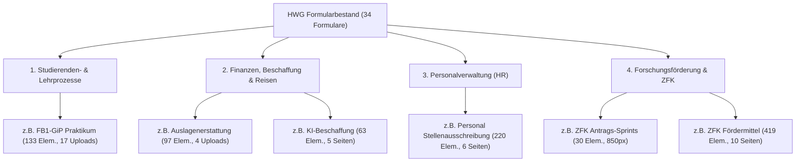

# Kapitel 3: Empirische Ist-Analyse des HWG-Formularbestands

**Projekt:** Konzeption eines einheitlichen Formular-Standards für die HWG Ludwigshafen und prototypische Umsetzung einer KI-gestützten Compliance-Prüfung in Formcycle  
**Autor:** Fotios Logaras  
**Datum:** Oktober 2026  

---

## 3.1 Erhebungsmethodik und Charakterisierung des untersuchten Formular-Korpus

Zur Identifikation bestehender Gestaltungs- und Usability-Inkonsistenzen wurde eine systematische Bestandsaufnahme an der Hochschule für Wirtschaft und Gesellschaft Ludwigshafen (HWG) durchgeführt. Der untersuchte Korpus umfasst **insgesamt 34 Formulare** im proprietären Formcycle-Format (`.xfp`), die sich auf das Produktivsystem (`prod`) sowie das Test- und Entwicklungssystem (`test`) verteilen.

Die Formulare wurden über ein automatisches Extraktionsskript dekomprimiert und deren interne JSON-Objektstrukturen (`.fcp`-Dateien) hinsichtlich Komponentenanzahl, Seitenanzahl, Theme-Zuordnung, Feldbreiten und Barrierefreiheitsattributen analysiert. Ergänzend wurden von 8 repräsentativen Formularen gerenderte HTML/DOM-Snapshots erhoben, um die tatsächliche Darstellung im Browser (Status -1, Antragsstellenden-Sicht) zu evaluieren.

### Kategorisierung der Formulare in 4 funktionale Archetypen

Die 34 analysierten Formulare spannen ein breites Spektrum administrativer Hochschulprozesse ab und lassen sich in vier Kern-Archetypen unterteilen:

1. **Studierenden- und Lehrbetrieb:** Anträge zu Praxisphasen und Notenmeldungen (z. B. `FB1-GiP_Praktikum`, 133 Elemente, 17 Dateiuploads).
2. **Finanzen, Beschaffung und Reisen:** Formulare für Haushalts- und Erstattungsprozesse (z. B. `Auslagenerstattung`, 97 Elemente; `HaushaltVergabevermerk`, 102 Elemente; `Dienstreiseantrag`, 424 Elemente auf 12 Seiten).
3. **Personal und Verträge:** Komplexe HR-Verwaltungsworkflows (z. B. `Personal_Stellenausschreibung`, 220 Elemente, 6 Seiten; `Personal_Vertragsaenderung`, 345 Elemente, 9 Seiten).
4. **Forschung und Transfer (ZFK):** Anträge auf Drittmittel und Forschungssprints (z. B. `AFörderung Antrag-Sprints`, 30 Elemente; `ZFK-Fördermittel`, 419 Elemente).

---

## 3.2 Heuristik-Audit und Identifikation der Kern-Problemfelder

Der empirische Vergleich offenbart deutliche Brüche in der Benutzerführung, im visuellen Erscheinungsbild und in der technischen Barrierefreiheit. Die Mängel lassen sich fünf zentralen Problemfeldern zuordnen:

### Problemfeld 1: Layout-Inkonsistenzen und starre Breitenbrüche (700px vs. 850px)
Die Formulare weisen keine einheitliche Breiten-Governance auf:
* **700px-Gruppe:** Ältere Formulare sowie das *Master-Formular* für persönliche Angaben sind starr auf eine Maximalbreite von `700px` fixiert (`max-width: 700px; min-width: 300px;`).
* **850px-Gruppe:** Neuere Formulare (insbesondere aus dem ZFK-Umfeld) nutzen starr `max-width: 850px;`.
* **Auswirkung:** Nutzende erleben beim Wechsel zwischen Formularen innerhalb desselben Hochschulportals abrupte visuelle Sprünge und variierende Zeilenlängen.

### Problemfeld 2: Uneinheitliche Corporate Identity (CI) und Header-Grafiken
* Formulare wie *Auslagenerstattung*, *FB1-Praktikum* oder *Stellenausschreibung* verfügen über das offizielle HWG-Logo bzw. einen einheitlichen Header-Banner.
* Neuere Anträge (z. B. *Antrag-Sprints für Drittmittel*) verzichten vollständig auf jedes Logo und beginnen direkt mit zentriertem Fließtext.
* **Auswirkung:** Fehlende Wiedererkennbarkeit und verringertes Vertrauen in die Authentizität des Formulars.

### Problemfeld 3: Heterogene Stammdaten-Strukturen trotz "Master-Formular"
Obwohl ein internes *Master-Formular* als Vorlage für persönliche Angaben existiert, wird dieses in den Fachabteilungen nicht konsistent nachgenutzt:
* **Reihenfolge der Namensfelder:**
  * *Auslagenerstattung:* `Vorname` (links) $\rightarrow$ `Nachname` (rechts).
  * *Antrag-Sprints:* `Name Antragstellende/r*` (links) $\rightarrow$ `Vorname Antragstellende/r*` (rechts).
* **Pflichtfeldkennzeichnung (Asterisks):**
  * Im *Master-Formular* sind Vorname, Nachname und E-Mail mit einem Pflichtfeldsternchen gekennzeichnet.
  * Im *FB1-Praktikum* fehlen diese Kennzeichnungen völlig, obwohl es sich um zwingende Pflichtfelder handelt.
* **Inkonsistente Benennungen:**
  * Das E-Mail-Feld wird wahlweise als `E-Mail`, `E-Mail-Adresse` oder `HWGLU-Email` bezeichnet.
* **Code-Artefakte im Frontend:**
  * Im *Master-Formular* wird ein interner Entwickler-Kommentar als regulärer Text gerendert:  
    *„Fieldset wird per JavaScript eingeblendet, wenn Shibboleth/LDAP-Member oder FormS-Admin oder FormS-Postfach-SB, ansonsten ausgeblendet (hide)“*.
  * Interne Feld-IDs weisen Tippfehler auf (z. B. `tfMasterFachbereichSudiengang`).

### Problemfeld 4: Schaltflächen-Wildwuchs und die Fallstudie „Kritischer Fall“
Die Beschriftung (Microcopy) und Positionierung von Aktions- und Navigationsschaltflächen ist hochgradig heterogen:
* **Absende-Buttons:** Variieren zwischen kleingeschriebenem `senden`, förmlichem `Antrag einreichen` und prozessbezogenem `Antrag an Führungskraft senden`.
* **Seitennavigation:** Variiert zwischen generischem `weiter` und spezifischem `weiter zu Seite 2`.
* **Fallstudie „Kritischer Fall“:**
  * Im *Antrag auf Förderung von Antrag-Sprints* existiert neben dem regulären (in diesem Zustand deaktivierten) `senden`-Button ein zweiter Aktionsbutton namens **`Kritischer Fall`**.
  * **Hintergrund:** Bei Anträgen mit besonderer Tragweite soll ein Prüfpfad über das Hochschulpräsidium erzwungen werden.
  * **Usability-Befund:** Ein Statusname (*„Kritischer Fall“*) wird fälschlicherweise als Handlungsschaltfläche (Button) verwendet. Dies verletzt die ISO 9241-110 (Erwartungskonformität), da Nutzende nicht erkennen können, ob es sich um eine Fehlermeldung, einen Abbruch oder ein alternatives Einreichen handelt.

### Problemfeld 5: Defizite bei der digitalen Barrierefreiheit (WCAG 2.1 / BITV 2.0)
* **Semantische Gruppierung:** Während ältere Formulare semantisch saubere `<fieldset>`- und `<legend>`-Tags verwenden, nutzen neuere Formulare ausschließlich unsemantische `
`-Container (`XContainer`). Screenreader können thematische Abschnitte dadurch nicht als Sinneinheiten identifizieren.
* **ARIA-Attribute:** Viele Pflichtfelder verlassen sich auf optische Sternchen (`*`), ohne das maschinenlesbare Attribut `aria-required="true"` zu setzen.

---

## 3.3 Vorher-Nachher-Dokumentation (Visuelle Nachweise)

Die identifizierten Mängel wurden exemplarisch anhand hochauflösender Bildvergleiche dokumentiert:

| Vergleichsbereich | Bild-Referenz 1 | Bild-Referenz 2 | Kernbefund |
| :--- | :--- | :--- | :--- |
| **Header & CI** | `Auslagenerstattung_Layout_Banner.png` | `Antrag_Sprints_Layout_Banner.png` | Fehlendes Hochschullogo, Breitenbruch 700px vs. 850px, invertierte Vorname/Nachname-Reihenfolge. |
| **Stammdaten-Block** | `Master_Formular_Persoenliche_Angaben.png` | `FB1_Praktikum_Persoenliche_Angaben.png` | Diskrepanz bei Pflichtfeldsternen, Entwicklerkommentar im Live-Formular, uneinheitliche Feldbreiten. |
| **Schaltflächen & Navigation** | `Stellenausschreibung_Button.png` | `Antrag_Sprints_Button.png` | Uneinheitliche Microcopy (`weiter zu Seite 2` vs. `senden`), problematischer Status-Button `Kritischer Fall`. |

---

## 3.4 Ableitung der Kernanforderungen für das Master-Regelwerk

Aus den empirischen Befunden leiten sich vier verbindliche Anforderungen an den zukünftigen Formular-Standard der HWG Ludwigshafen ab:

1. **Standardisiertes Layout-Grid:** Verbindliche Festlegung auf eine responsive Einheitsbreite (Empfehlung: 850px für Desktop, responsive Anpassung bei mobilen Geräten) und einheitliches Corporate-Design-Header-Banner.
2. **Komponenten-Pattern für Stammdaten:** Formalisierung eines universellen Komponentenmusters für persönliche Daten (einheitliche Reihenfolge: Anrede $\rightarrow$ Vorname $\rightarrow$ Nachname; verbindliche Benennung: `E-Mail`).
3. **Microcopy-Governance für Buttons:** Klare Vorgaben für Schaltflächen-Texte (Aktivverben im Infinitiv: *„Antrag einreichen“*, *„Weiter“*, *„Zurück“*). Trennung von Workflow-Weichen (z. B. Checkbox für Präsidiumsbeteiligung) und dem primären Submit-Button.
4. **Verbindliche Barrierefreiheitsregeln (BITV 2.0):** Zwingender Einsatz von `<fieldset>` mit Legenden für logische Abschnitte; konsistentes Zusammenspiel von visuellen Sternchen (`*`) und `aria-required="true"`.

Diese Anforderungen bilden die inhaltliche Grundlage für die Formalisierung in der maschinenlesbaren `rules_registry.json`.
