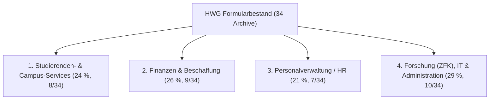

# Kapitel 3: Empirische Ist-Analyse des HWG-Formularbestands (Kurzfassung)

**Projekt:** Konzeption eines einheitlichen Formular-Standards für die HWG Ludwigshafen und prototypische Umsetzung einer KI-gestützten Compliance-Prüfung in Formcycle  
**Autor:** Fotios Logaras  
**Stand:** Oktober 2026  

---

## 3.1 Erhebungsmethodik und Charakterisierung des Korpus

Der untersuchte Bestand an der HWG Ludwigshafen umfasst **34 Formcycle-Exportarchive (`.xfp`)** (`prod`: 13, `test`: 21; bereinigt um 9 Systemdubletten entsprechen diese 25 fachlich eigenständigen Formularprojekten) sowie **34 Workflow-Modelle (`workflowVersions`)** in 53 `.fcexport`-Projektdateien und 8 gerenderte HTML-DOM-Snapshots aus Antragstellenden-Sicht.

### Vier funktionale Archetypen

---

## 3.2 Sechs empirische Kernproblemfelder

1. **Layout-Spaltung (700 px vs. 850 px):** **53 % (18/34)** nutzen starre `700px`-Container (darunter `Auslagenerstattung`, `FB1-GiP_Praktikum` und `Master-Formular`), **47 % (16/34)** nutzen `850px`.
2. **Corporate Identity & Header-Struktur:** **100 % (34/34)** weichen bei Header-Logo (fehlend oder `50px` ohne `alt`-Text statt `60px` rechtsbündig mit Alternativtext) ab; **97 % (33/34)** besitzen keine `<h1>`-Überschrift im Header; **47 % (16/34)** haben im Footer das Herstellerlogo (`showlogo="1"`) aktiviert.
3. **Dezentrale Copy-Paste-Abwandlungen & Entwicklernotizen:** Das interne `Master-Formular` enthält eine im Frontend sichtbare Shibboleth/LDAP-Entwicklernotiz (`XSpan.rtevalue`, `HWG-UI-01`) und wird uneinheitlich kopiert (`Vorname`/`Nachname`/`E-Mail` vs. `HWGLU-Email` oder `Name Antragstellende/r`).
4. **Schaltflächen-Microcopy & Fallstudie „Kritischer Fall“:** Neben generischem `senden` und uneinheitlicher Pagination (`weiter`, `zurück` in 24/24 mehrseitigen Formularen mit Navigations-Buttons) nutzt `Antrag-Sprints` (ZFK) den Button **`Kritischer Fall`**. Da fachlich ein expliziter Auslöser für kritische Förderfälle erwünscht war, liegt der Usability-Verstoß im Fehlen eines infinitiven Handlungsverbs (*Action-Verb-Pattern*): Zulässig und verständlich ist **`Kritischen Fall einreichen`**, nicht jedoch das verblose Substantiv `Kritischer Fall`.
5. **Barrierefreiheit, Datenschutz & Formatvalidierung:** **47 % (16/34)** enthalten kein einziges `XFieldSet` (**56 %** verfehlen insgesamt `HWG-A11Y-01`), **76 % (26/34)** weisen HTML-/Formatierungsfragmente in Labels auf (`HWG-A11Y-03`), **82 % aller Formulare (28/34; 85 % der 33 personenbezogenen Formulare)** erheben Personendaten ohne Art.-13-DSGVO-Hinweis (`HWG-DSGVO-01`) und **56 % (19/34)** lassen strukturierte Eingaben unvalidiert (`HWG-VAL-01`).
6. **Workflow-Fragmentierung:** **56 % (19/34)** mehrstufige, jedoch abteilungsisolierte Workflows stehen **44 % (15/34)** Einzelaufgaben gegenüber; **91 % (31/34)** verletzen die kanonische Statusnomenklatur (`HWG-WF-01`) und **76 % aller Formulare (26/34; 84 % der 31 Formulare mit E-Mail-Versand)** verfehlen die durchgängige Vorgangsreferenz `[%$RECORD_ID%]` in Prozess-E-Mails (`HWG-WF-02`; davon 24/34 gänzlich ohne Vorgangs-ID, 2/34 unvollständig, 3/34 ohne E-Mails).
